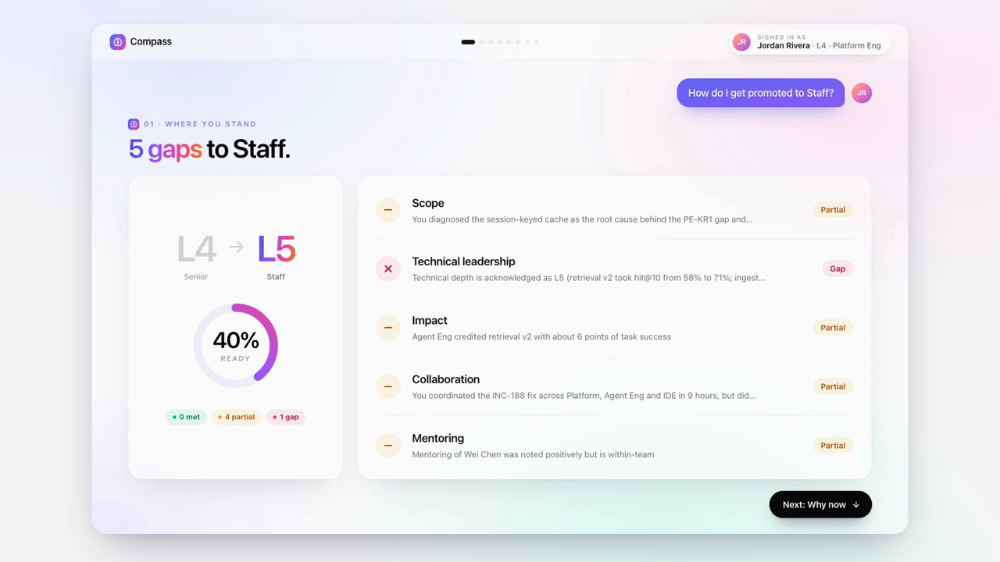
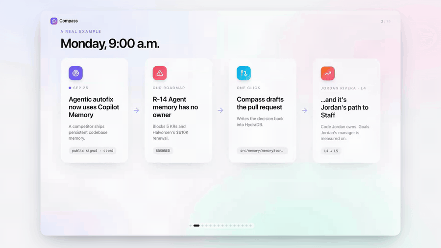
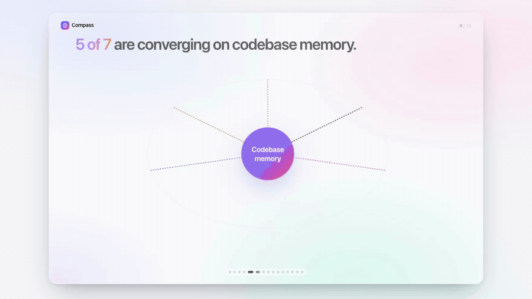
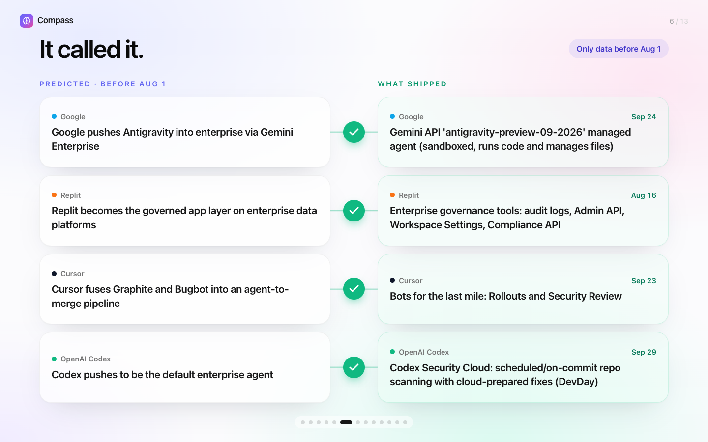
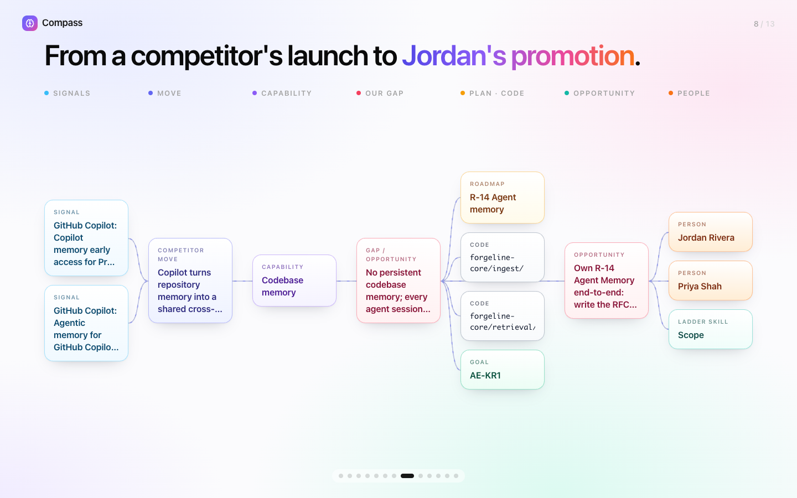
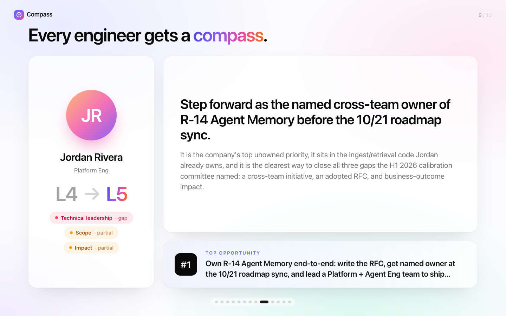
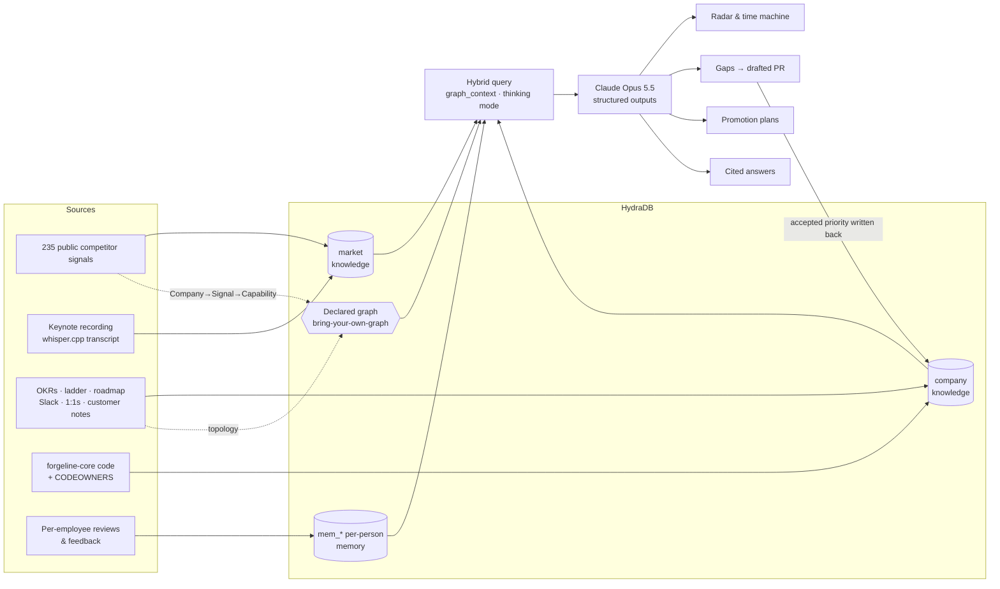

<div align="center">

# Compass

### The company brain that turns market moves into roadmaps — and roadmaps into promotions.

Built in one day at the **Company Brain Hackathon** (Oct 12, 2026) on **HydraDB**, **Claude** and **App-Starter**.

[**▶ Watch the demo video**](https://github.com/bouncypitch/compass-company-brain/releases/latest) · [**Try the live demo**](https://bouncypitch.github.io/compass-company-brain/) · [How it works](#how-it-works) · [Run it locally](#run-it-locally)

<a href="https://github.com/bouncypitch/compass-company-brain/releases/latest"></a>

</div>

---

## The 3-minute story

**Jordan Rivera**, a senior engineer, asks Compass: *"How do I get promoted to Staff?"* Compass answers by walking the whole company brain:

1. **Where you stand:** the career ladder and Jordan's reviews give 40% readiness, with one clear gap.
2. **Why now:** the market moved. The 235-signal heatmap shows 5 of 7 competitors converging on codebase memory, and the time machine shows it predicted their launches.
3. **The opportunity:** R-14 Agent memory has no owner, blocks 5 goals and a $610K renewal, and lives in code Jordan already owns.
4. **Make it yours:** one click claims R-14, writes the decision into HydraDB and drafts the PR.
5. **Your 90 days, and who to talk to:** a dated plan, plus Jordan's live company graph (drag it around).

It opens with the hackathon's own keynote. Asked what a company brain should ultimately do, Compass finds the exact moment in the recording: *"…not to just ask questions, but also then to take action."*

## The idea

Every company already has a brain. It's just scattered — across Slack, roadmaps, code, performance reviews and the market outside. And every engineer asks the same question: **"what should I work on to get promoted?"**

Compass connects three things no single person can see at once:

1. **The market** — what competitors are actually shipping, hiring for and winning.
2. **The company** — goals, KRs, roadmap, code ownership, conversations and customers.
3. **The person** — the career ladder and each engineer's own reviews and strengths.

…and then it **acts**: it finds the unowned work that matters, drafts the pull request, and tells each engineer which piece is their path to the next level.

<p align="center"></p>

## What it does

| | |
|---|---|
| **Radar** | Tracks **7 real AI-coding competitors** (Cursor, Cognition, GitHub Copilot, Replit, OpenAI Codex, Google, Amazon) through **235 verified public signals** — launches, hiring, leadership changes, government contracts, research papers, acquisitions, market entries, pricing. Every signal links to its source. Predicts each competitor's next move with confidence and finds industry-wide patterns. |
| **Time machine** | Hides every signal after Aug 1, predicts, then reveals what actually shipped. It called Cursor's Rollouts/Security Review, Google's Antigravity enterprise push and Replit's governance tools — weeks early. |
| **Strategy → pull request** | Maps market moves onto the (fictional) startup Forgeline's roadmap, KRs and code: *"R-14 Agent memory is unowned and blocks 5 goals and a $610K renewal."* One click writes the decision back into HydraDB and drafts a 4-file PR against the real codebase. |
| **Compass (promotion coach)** | For any engineer: ladder gaps with cited evidence, ranked opportunities that close those gaps *and* move the KRs their manager is measured on, people to talk to, and a 90-day plan. |
| **Ask the brain — by voice** | Ask anything, typed or spoken, and get cited answers with the HydraDB graph paths it followed — including from **today's keynote recording**, with the exact moment playable. |
| **Company graph** | 25 people, 9 teams, 15 KRs, 18 roadmap items, 15 code modules, conversations, customers and tickets — **267 relationships**, explorable with focus mode. |

<p align="center">
  
  
</p>
<p align="center">
  
  
</p>

## How it works



- **HydraDB is the memory.**
  - A shared `company` collection holds OKRs, the ladder, the roadmap, Slack threads, 1:1s, customer notes and the code.
  - A `market` collection holds the competitor signals and the keynote transcript.
  - Per-employee `mem_*` memory collections hold each person's history.
  - **Bring-your-own-graph** declares the spine the demo must always show. The market side is Company → Signal → Capability. The company side is a deterministic topology built from systems of record: people → teams → managers, owners → KRs → goals, roadmap → code, and conversations → people / roadmap items / tickets.
  - Queries use hybrid search with `graph_context` in thinking mode, and the UI renders HydraDB's own graph paths.
- **Claude** reasons over the retrieval with schema-validated structured outputs: competitor moves, gaps, promotion plans, cited answers. It also streams the drafted PR.
- **The brain learns:** accepting a recommendation writes it back into HydraDB with its graph edges, and the UI shows the indexing status move from `queued` to `completed`.
- **Built for live demos:** every result is cached per organization, so the demo replays instantly. New questions run live.
- **Honest by design:**
  - Competitor data is public and cited, with no speculation about named individuals.
  - The time machine uses a hard cutoff.
  - The promotion coach never reveals other people's private feedback.
  - Forgeline and its people are fictional.

Ontology research behind the graph design: [`docs/company-brain-ontology.md`](docs/company-brain-ontology.md).

## Repository map

```
apps/api/src/brain/        NestJS module: HydraDB wrapper, Claude service, topology builder, endpoints
apps/api/scripts/          hydra-ingest.ts (loads everything into HydraDB), seed-forgeline-users.ts
apps/web/src/components/   brain/ (product UI) · demo/ (keynote deck) · journey/ (Jordan's journey)
data/external/<company>/   verified competitor signals (signals.json) with time-machine candidates
data/internal/             fictional Forgeline: OKRs, ladder, roadmap, Slack, 1:1s, customer notes, people
data/memories/             per-employee reviews & feedback
data/codebase/             forgeline-core — the codebase the brain drafts PRs against
demo/video/                Playwright recorder, ElevenLabs narration, ffmpeg compositor for the demo video
```

## Run it locally

Requirements: Node 22+, pnpm 10, PostgreSQL and Redis (Homebrew works: `brew install postgresql@17 redis`), API keys for **HydraDB** and **Anthropic**.

```bash
git clone https://github.com/bouncypitch/compass-company-brain.git && cd compass-company-brain
cp apps/api/.env.example apps/api/.env && cp apps/web/.env.example apps/web/.env.local
# add HYDRA_DB_API_KEY and ANTHROPIC_API_KEY to apps/api/.env
pnpm install
pnpm --filter @app-starter/api exec prisma migrate deploy
pnpm --filter @app-starter/api run prisma:seed
cd apps/api && pnpm exec ts-node scripts/seed-forgeline-users.ts && pnpm exec ts-node scripts/hydra-ingest.ts && cd ../..
pnpm dev
```

Open http://localhost:3000 and sign in as **jordan@forgeline.dev** / `Password123!`:
- **/demo** — keynote deck
- **/journey** — Jordan's promotion journey (sign in as Jordan)
- **/brain** — the full product: Radar, Compass, Story, Ask, Org map

## Built with

[HydraDB](https://hydradb.com) · [Claude](https://www.anthropic.com) (Opus 5.5) · [App-Starter](https://github.com/digohq/app-starter) (NestJS, Next.js, Prisma, PostgreSQL, Redis) · React Flow · ElevenLabs (narration) · whisper.cpp (keynote transcript) · Playwright + ffmpeg (video)

## Credits

- Built on **[App-Starter](https://github.com/digohq/app-starter)** by Digo, under the MIT License. Its original README is in [`docs/APP-STARTER.md`](docs/APP-STARTER.md).
- Competitor data comes from public sources, cited per signal.
- Keynote audio clips are from the Company Brain Hackathon keynote, used with thanks to the organizers.
